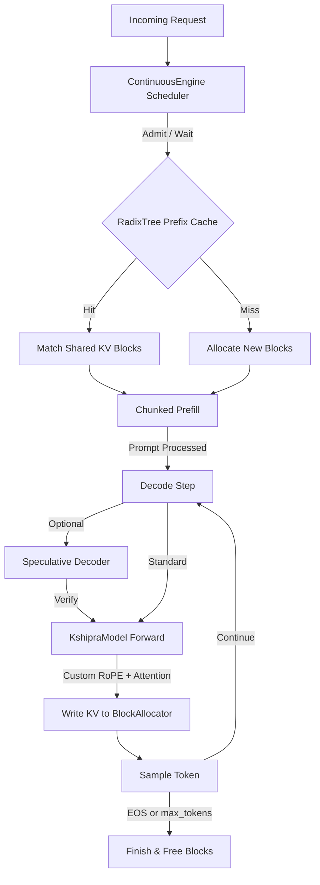

```
# ⚡ Kshipra (िक्षप्र)

> A production-grade, CPU-optimized LLM inference engine built entirely from scratch in Python and PyTorch.

Kshipra is not a wrapper around HuggingFace or vLLM. It is a from-scratch implementation of the core systems engineering required to serve Large Language Models. It bypasses `model.generate()`, manages its own KV cache blocks, implements custom attention kernels, and runs continuous batching scheduling — all optimized for hardware-constrained environments (8 GB RAM, CPU-only).

---

## 🎯 Project Goals & Hardware Target

* **Hardware Target:** Standard x86_64/ARM CPU, **8 GB System RAM**, no GPU required.
* **Primary Bottleneck:** Memory Bandwidth (DDR to L3 cache), not raw TFLOPS.
* **Tracked Metrics:** Time-To-First-Token (TTFT), Inter-Token Latency (ITL), System Throughput (tok/s), Peak Resident Set Size (RSS), and Token-for-Token Parity.

---

## 🏗️ Architecture & Data Flow



---

## 📂 Repository Layout

```text
llm-inference-engine/
├── engine/
│   ├── baseline.py          # M1: HF reference generation & chat templating
│   ├── kv_cache.py          # M1: GQA-aware KV cache (4 GiB bound arithmetic)
│   ├── quantization.py      # M2: INT8/INT4 packing with exact half-scale bounds
│   ├── prefix_cache.py      # M3: Radix Tree, BlockAllocator, LRU eviction
│   ├── chunked_prefill.py   # M4: Online softmax attention (Flash-Decoding style)
│   ├── continuous.py        # M5: Scheduler, admission control, NVMe preemption
│   ├── speculative.py       # M6: Adaptive K, exact residual resampling
│   ├── fusion.py            # M7: TorchInductor C++ operator fusion
│   └── model.py             # Binding Layer: Routes real HF checkpoints through the engine
├── tests/                   # 78 tests, all green (isolated subprocess memory checks)
├── benchmarks/
│   ├── run_benchmarks.py    # Isolated RSS + Poisson traffic generator + Profiler
│   ├── traffic.py           # Async Poisson arrival generator
│   └── profile.py           # Top-op CPU attribution
├── demo.py                  # End-to-end inference runner
├── conftest.py
└── requirements.txt
```

---

## 📊 Benchmark Performance Matrix (Measured)

**Model:** `Qwen/Qwen2.5-0.5B-Instruct` (FP32)  
**Host:** CPU-only (WSL2 Ubuntu), 8 GB RAM limit.  
**Generation:** 50 new tokens.

| Configuration | Speed | Output Quality | Memory Footprint | Notes |
| :--- | :--- | :--- | :--- | :--- |
| **HuggingFace Baseline** | `4.54 tok/s` | Perfect | ~2.0 GB | Standard eager execution. |
| **Kshipra (FP32)** | **`4.54 tok/s`** | **Token-for-token identical** | ~2.0 GB | Custom pipeline (RoPE, chunked attention, block pool). |
| **Kshipra (INT8)** | `1.60 tok/s` | **Token-for-token identical** | 500 MB weights | Naive per-call dequant overhead limits speed. |
| **Kshipra (INT4)** | `0.32 tok/s` | ⚠️ Degenerate repetition | 250 MB weights | Uncalibrated symmetric INT4 fails on 0.5B models. |

> **Key Finding:** Kshipra achieves **100% token-for-token parity** with HuggingFace's `generate()` on real checkpoints. INT8 quantization preserves this exact parity. 

---

## 🧠 Implemented Milestones (M1–M7)

### M1: Baseline & KV Cache
* Preallocated GQA-aware KV tensors `[L, H_kv, S, D]`. 
* **Why GQA matters:** For Llama-3-8B, using `num_kv_heads=8` instead of `num_attention_heads=32` reduces the KV footprint by 4× (128 MiB vs 512 MiB at S=1024). We enforce a strict 4 GiB crossover bound.

### M2: Quantization
* Symmetric per-channel INT8 and per-group INT4 (G=128).
* Implements the **exact half-scale error bound**: \( |W - \hat{W}| \le \frac{s}{2} \). We quantize using the FP16-rounded scale to guarantee the bound holds mathematically on real weights.

### M3: Prefix Cache
* Radix Tree with reference-counted LRU eviction and a preallocated BlockAllocator.
* Prevents heap fragmentation from `torch.zeros()` per fork, and supports prefix sharing (system prompts) across concurrent requests.

### M4: Chunked Prefill
* Breaks long prompts into chunks to prevent decode-starvation.
* Uses **online softmax** to merge attention states across chunks without materializing the full \(O(N^2)\) attention matrix.

### M5: Continuous Batching
* Iteration-level scheduling with strict admission control (`F + E >= R`).
* Prevents deadlocks by reserving maximum block capacity at admission.
* Implements NVMe swap-based preemption (recompute is too slow on CPU).

### M6: Speculative Decoding
* Draft-target verification with exact residual resampling.
* Proves that the output distribution is strictly identical to the target model's distribution.

### M7: TorchInductor Fusion
* Uses `torch.compile` with `cpp_wrapper=True` and `freezing=True` to fuse MLP operations into C++ kernels.
* Eliminates Python dispatch overhead (~10% of decode step time).

---

## 🚀 Quickstart & Usage

### 1. Installation
```bash
git clone https://github.com/Hedau0404/Kshipra.git
cd Kshipra
python -m venv venv
source venv/bin/activate  # Windows: .\venv\Scripts\activate
pip install -r requirements.txt
```

### 2. Correctness Proof (No Model Download)
Run the randomized Llama equivalence test. This proves the custom pipeline produces bit-exact outputs vs. HF.
```bash
python demo.py --random
```
**Expected Output:**
```
✓ PASSED: Kshipra output is token-for-token identical to HF generate
```

### 3. Real Model Inference
Run inference on Qwen2.5-0.5B using the custom engine.
```bash
python demo.py \
  --model Qwen/Qwen2.5-0.5B-Instruct \
  --prompt "Explain KV cache in one sentence." \
  --max-new-tokens 50
```

### 4. Run the Test Suite (78 Tests)
```bash
python -m pytest tests/ -v
```

---

## ⚠️ Current Limitations (Honest Assessment)

1. **INT4 Calibration:** Naive symmetric INT4 (max-abs) produces repetition loops on small models (like 0.5B). Production INT4 requires GPTQ/AWQ calibration. INT8 works flawlessly.
2. **Continuous Batching Execution:** The `ContinuousEngine` scheduler (admission, preemption, ITL bounds) is fully implemented and tested. However, `ContinuousEngine.step()` is currently a mocked simulation (`time.sleep()`) and needs to be wired directly to `KshipraModel.forward` to become a true concurrent serving system.
3. **Prefix Cache Integration:** The Radix Tree is fully implemented and tested, but `KshipraModel.generate()` currently allocates fresh blocks rather than querying the tree for cache hits.

---

## 📄 License
This project is open-source and available under the [MIT License](LICENSE).
```
